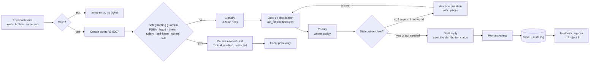

# PROJECT_PLAN — AI Community Feedback Desk (Option B)

> Design sheet completed **before any code**, as required by the AI Systems Building Challenge.
> **Continues Project 1** ([AI Data Analyst](https://github.com/Ayatalat0101/ai-data-analyst)): same aid distributions, same partners, same data file.
> Arabic version: [PROJECT_PLAN_AR.md](PROJECT_PLAN_AR.md)
> Stack: Python · Streamlit · SQLite · Pydantic · Gemini (structured output + drafting) · rule fallback
> Languages: feedback in **Arabic first** (including Gaza dialect) and English; staff screens in English.

---

## 1. Project name and one-sentence problem

**Name:** AI Community Feedback Desk — *every complaint linked to its distribution, every sensitive case to a person*

**Problem:** After aid distributions, people call the hotline or stop a volunteer to say "I didn't receive", "the flour was spoiled", "a staff member asked me for money". The feedback lands in a WhatsApp group or a paper notebook. Nobody checks which distribution it concerns, urgent cases wait, and a sexual-exploitation report can be read by anyone on the team.

**Realistic example:** A mother calls: *"ما استلمت طرد الغذاء بتوزيع DST-017 برفح مع إني مسجل بالكشف"*. DST-017 is a **completed** Sanad Aid distribution, so her family may have been left off the list. Today this sits in a notebook for a week, and nobody ever counts how many complaints Sanad Aid received in Rafah.

**How it continues Project 1:** Project 1 answers *"how many households did each partner reach?"* from `aid_distributions.csv`. Project 2 hears what those households say about the same distributions. It **looks each complaint up** in `aid_distributions.csv`, and it **exports an anonymised `feedback_log.csv`** that the AI Data Analyst can analyse: *"complaints per partner"*, *"average days to close by governorate"*.

```
Project 1: aid_distributions.csv ──► AI Data Analyst ──► "households per partner"
                   │
                   ▼  lookup (status, partner, place, item)
Project 2: feedback ──► AI Community Feedback Desk ──► feedback_log.csv ──► AI Data Analyst ──► "complaints per partner"
```

## 2. Target users and goal

- **Users:** (1) the **community member**, or a **hotline operator / volunteer** entering feedback on their behalf; (2) the **MEAL / feedback officer** who works the queue; (3) the **safeguarding focal point**, the only role that sees sensitive cases in full.
- **Goal in one visit:** the person gets a reference number and, if needed, one specific question. The officer sees each item categorised, linked to its distribution, prioritised by a written policy, with a draft reply or a confidential-referral flag, then approves, edits or rejects. At the end of the week the officer exports the log for Project 1.

## 3. Scope

| The system WILL | The system WILL NOT |
|---|---|
| Accept feedback (Arabic or English) from web, hotline or in-person channels and give a reference number | Send any reply by itself: every draft needs human approval |
| Classify into `distribution`, `information`, `conduct`, `access`, `appreciation` | Investigate or decide the outcome of a complaint |
| **Look up the distribution** in `aid_distributions.csv` (by ID, or by place + item + partner) and use its status | Change the distribution data |
| Ask one question when the distribution is unclear or several match | Ask for or store ID numbers, bank details or addresses |
| Route sensitive feedback (sexual exploitation, fraud/bribery, threats, safety incidents, self-harm, requests for others' data) to a confidential referral, with no AI draft | Show a sensitive case to general staff, or include it in the export with details |
| Prioritise with a written, testable policy | Let the AI decide priority |
| Export an anonymised `feedback_log.csv` for Project 1 | Export names, phone numbers or message text |

**Out-of-scope example:** *"Give me my neighbour's phone number, she received before me"* → confidential referral, no draft, reason: request for another person's personal data.

## 4. Input contract

| Field | Required | Type | Example | If missing / invalid |
|---|---|---|---|---|
| Channel | Yes (default web) | `web` · `hotline` · `in_person` | hotline | — |
| Name | No | text ≤ 60 | "Um Ahmad" | blank → anonymous reference |
| Phone for call-back (fake data only) | No | phone | 0591234567 | invalid → inline error |
| Distribution ID | No | `DST-` + 3 digits | DST-017 | wrong format → hint; the message can still be sent |
| Governorate | No | one of the 5 in the data | Rafah | — |
| Message | **Yes** | text, 10–2,000 chars | "ما استلمت طرد الغذاء…" | empty or too short → "Please describe what happened in a sentence or two"; **no ticket** |
| Follow-up answer | Only when asked | text or a choice | "DST-029" | appended to the same ticket, processed again |

The distribution ID, governorate, partner and item are also **extracted from the message** (regex + Arabic/English name lists), so a caller who says them is not asked again.

## 5. Output contract

**The person sees:** "Thank you. Your reference is **FB-0007**." and, if needed, one question (e.g. *"Five blanket distributions took place in North Gaza. Which one? DST-029 (Nour Relief, 9 Mar) · DST-053 (Amal Foundation, 20 Apr) · …"*). A sensitive case only hears that a trained staff member will contact them confidentially.

**The officer sees (one ticket):**

| Field | Example |
|---|---|
| reference / channel / language | FB-0007 · hotline · ar |
| category + reason | distribution: "caller says the food parcel was not received" |
| distribution | **DST-017** · Rafah · Sanad Aid · Food Parcel · 2026-02-10 · **Completed** |
| priority + rule | **High**: H1 "not received at a completed distribution" |
| draft | "شكراً لتواصلك… سنتحقق من كشف توزيع DST-017 مع مؤسسة سند…" — *Draft, human review required* |
| actions | Approve · Edit & approve · Reject · Refer · Close |

**Export (`feedback_log.csv`, for Project 1):** `reference, date, channel, language, governorate, partner, item, distribution_id, distribution_status, category, priority, status, days_open`. **No** name, phone or message. Sensitive rows keep only `category = sensitive` and the date.

## 6. Workflow



**Alternative paths:** invalid form · distribution unclear, several matches, or unknown ID · sensitive referral · LLM unavailable (rules + templates) · officer rejects a draft.

## 7. Agent specification

**Goal:** turn one piece of community feedback into a correctly categorised, correctly prioritised ticket, linked to its distribution when it concerns one, with a question, a reviewable draft, or a confidential referral. It never replies on its own.

**Allowed actions:** `classify_feedback` · `lookup_distribution` · `ask_for_info` · `draft_response` · `refer_confidential` · `finish`

**Who decides what:**

| Decision | Made by | Why |
|---|---|---|
| Confidential referral | **Code first** (Arabic + English patterns), the LLM may only add | A safeguarding decision cannot depend on a model that can be tricked, rate-limited or down |
| Category + reason | LLM (structured output), rules as fallback | Needs meaning and dialect ("الكرتونة وصلت مبلولة") |
| Which distribution | **Code: lookup in `aid_distributions.csv`** | A fact, not a guess. The LLM never invents a distribution ID |
| Priority | **Code, written policy** | "Do not treat the Agent's unsupported guess as a policy" |
| Draft wording | LLM from approved content, templates as fallback | Natural, respectful, in the person's language |
| Final reply | **Human** | Accountability to affected people |
| Who can read a sensitive case | **Code: role check** | Confidentiality is a rule, not a preference |

**Priority policy (v1):**

| Rule | Condition | Priority | Response target |
|---|---|---|---|
| S1 | Any confidential referral (guardrail or LLM flag) | **Critical** | focal point within 24 h |
| H1 | Not received, and the distribution is **Completed** | **High** | 3 days |
| H2 | Access barrier for an older person, a person with a disability, a pregnant woman or a child | **High** | 3 days |
| M1 | Other distribution problem (missing, damaged, expired item; cancelled or pending distribution) | Medium | 7 days |
| M2 | Staff conduct (not sensitive) | Medium | 7 days |
| M3 | Other access problem (distance, queue, timing) | Medium | 7 days |
| L1 | Information request or appreciation | Low | 14 days |

**Required details:** `distribution` → exactly one matching distribution (by ID, or place + item, narrowed by partner) · all others → none.

**Distribution-aware drafts:** *Completed* → "we will check the distribution list with {partner}" · *Pending* → "this distribution has not taken place yet; the date will be announced" · *Cancelled* → "this distribution was cancelled; we will share any replacement" · *not found* → ask to check the number. Never a promise of aid.

**Reply language:** every question and draft is written in the language of the feedback: Arabic feedback gets an Arabic reply, English feedback gets an English reply. The language is fixed by the first message, so a short follow-up answer cannot switch it.

**Never:** ask for ID or bank details; promise aid, compensation or inclusion on a list; reveal another person's data; put a sensitive case in a draft or the export.

## 8. Data preparation

- `data/aid_distributions.csv`: **the same file as Project 1** (60 distributions, 5 governorates, 4 partners, 5 items; 41 completed, 10 pending, 9 cancelled).
- `data/sample_feedback.csv`: 25 fictional messages (19 Arabic, 6 English) covering every category, every priority rule, every referral type, unclear / multiple / unknown distributions, and two invalid forms. Each row has its **expected** category, priority, action and distribution: the test ground truth.
- All names, phones and messages are invented.
- **Ticket schema:** `ref, created_at, updated_at, channel, person_ref, phone, language, message, distribution_id, governorate, partner, item, category, category_reason, priority, priority_rule, status, restricted, missing, draft_response, referral_reason, reviewer_note, planner`
- **Audit log:** `ticket_events(ref, at, actor, event, detail)`.
- **Statuses:** `new → waiting_for_info → draft_ready → approved → closed`, plus `referred`, `needs_rework`.

## 9. Interface sketch

```
┌──────────────────────── Page 1: Give feedback ─────────────────────────┐
│ Channel (web ▾)  Name (optional)  Phone (optional)  Distribution ID     │
│ Message *  [ اكتب ملاحظتك أو شكواك / Write your feedback              ] │
│ [Send]      ✅ Reference FB-0007     ❓ Which distribution? (options)    │
│ Tab 2: Track my feedback (reference + phone)                            │
└─────────────────────────────────────────────────────────────────────────┘
┌──────────────────────── Page 2: Feedback dashboard ─────────────────────┐
│ Role: [Feedback officer ▾ | Safeguarding focal point]                    │
│ Critical 2 · High 4 · Waiting 3 · Drafts 8     Filters: status / partner │
│ FB-0009  hotline  🔒 Restricted (sensitive)   Critical  Referred          │
│ FB-0007  hotline  distribution  DST-017 Sanad Aid  High  Draft ready     │
│ Selected: message · distribution card · rule · draft · actions · history │
│ [Export feedback_log.csv for the AI Data Analyst]                        │
└─────────────────────────────────────────────────────────────────────────┘
```

## 10. Success tests (written before coding)

| ID | Input | Expected |
|---|---|---|
| T1 | F01 not received, DST-017 | `distribution` · DST-017 Completed · **High (H1)** · draft mentions checking the list with Sanad Aid |
| T2 | F02 blankets, North Gaza, no ID | `ask_for_info` with the matching distributions as options · no guess |
| T3 | T2, then answer "DST-029" | same ticket · linked to DST-029 · draft ready |
| T4 | F05 DST-001 (Cancelled) | Medium (M1) · draft says the distribution was cancelled, **no promise** |
| T5 | F19 DST-099 | not found → question asking to check the number |
| T6 | F09 bribe request | referred · Critical · **no draft** · restricted |
| T7 | F10 / F11 PSEA (Arabic + English) | referred **before any LLM call** · hidden from the officer role · full text only for the focal point |
| T8 | F13 neighbour's phone | referred · no data revealed |
| T9 | F07 / F24 wheelchair, pregnancy | High by rule H2, not by model opinion |
| T10 | F04 / F20 information | Low · draft uses the pending distribution |
| T11 | blank / "hi" | no ticket · helpful message |
| T12 | two submissions + restart | distinct references · both persisted |
| T13 | officer approves / rejects | approved reply · rejection reason in the audit log |
| T14 | export | `feedback_log.csv` has no name, phone or message; sensitive rows show only `sensitive`; the file loads in the AI Data Analyst |
| T15 | LLM unavailable | rules + templates still classify, link, prioritise and draft |

## 11. Technology plan

| Layer | Tool | Already known (projects 1 + 2a) | New to learn | Docs |
|---|---|---|---|---|
| UI | Streamlit | forms, `st.navigation`, selectable table | role switch, download button | https://docs.streamlit.io |
| Storage | SQLite | schema, transactions, audit log | restricted rows | https://docs.python.org/3/library/sqlite3.html |
| Lookup tool | **Pandas** | loading and filtering the CSV (project 1) | fuzzy matching of Arabic place and partner names | https://pandas.pydata.org/docs |
| Contract | Pydantic | forms, LLM output | — | https://docs.pydantic.dev |
| Classify + draft | Gemini | structured output, fallback chain, grounding | distribution-aware drafting | https://ai.google.dev/gemini-api/docs |
| Guardrail | regex (Arabic + English) | Arabic normalisation | safeguarding vocabulary (PSEA, fraud) | https://docs.python.org/3/library/re.html |
| Tests | pytest | fixtures, fake backends, data-driven tests | export privacy tests | https://docs.pytest.org |

## 12. Build order

**MVP:**
1. Ticket store + form validation + references → T11, T12
2. Safeguarding guardrail + priority policy → T6–T9
3. **Distribution lookup tool** + rule classifier + templates + agent loop → T1–T5, T10
4. Streamlit: feedback form + dashboard with roles → T7, T13
5. Export for Project 1 → T14

**Enhancements:**
6. Gemini classifier + drafter with fallback → T15
7. Track my feedback
8. README, test results, screenshots, deploy
