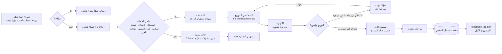

<div dir="rtl">

# خطة المشروع: مكتب ملاحظات وشكاوى المجتمع بالذكاء الاصطناعي (الخيار B)

> ورقة تصميم اكتملت **قبل كتابة أي كود**، كما يشترط تحدّي AI Systems Building Challenge.
> **تكملة للمشروع الأول** ([AI Data Analyst](https://github.com/Ayatalat0101/ai-data-analyst)): نفس توزيعات المساعدات، ونفس الشركاء، ونفس ملف البيانات.
> التقنيات: Python · Streamlit · SQLite · Pydantic · Gemini (مخرجات منظّمة + كتابة المسودّات) · قواعد احتياطية
> اللغات: الملاحظات **بالعربية أولاً** (ومنها لهجة غزة) وبالإنجليزية؛ شاشات الموظفين بالإنجليزية.
>
> النسخة الإنجليزية الأصلية: [PROJECT_PLAN.md](PROJECT_PLAN.md)

---

## 1. اسم المشروع والمشكلة في جملة واحدة

**الاسم:** مكتب ملاحظات المجتمع الذكي: *كل شكوى مربوطة بتوزيعها، وكل حالة حساسة تذهب لإنسان*

**المشكلة:** بعد توزيعات المساعدات، يتصل الناس بالخط الساخن أو يوقفون متطوعاً ليقولوا "ما استلمت"، "الطحين كان خربان"، "موظف طلب مني مصاري". تنتهي الملاحظة في مجموعة واتساب أو دفتر ورقي. لا أحد يتحقق من التوزيع الذي تخصه، والحالات العاجلة تنتظر، وبلاغ عن استغلال جنسي قد يقرأه أي شخص في الفريق.

**مثال واقعي:** أم تتصل وتقول: *"ما استلمت طرد الغذاء بتوزيع DST-017 برفح مع إني مسجل بالكشف"*. التوزيع DST-017 **مكتمل** ونفّذته مؤسسة سند، فربما سقطت عائلتها من الكشف. اليوم تبقى هذه الشكوى في دفتر أسبوعاً، ولا أحد يعدّ كم شكوى وصلت عن سند في رفح.

**كيف يكمّل المشروع الأول:** المشروع الأول يجيب عن *"كم أسرة وصلها كل شريك؟"* من ملف `aid_distributions.csv`. المشروع الثاني يسمع ما تقوله هذه الأسر عن نفس التوزيعات. فهو **يبحث عن كل شكوى** في `aid_distributions.csv`، و**يصدّر ملف `feedback_log.csv` بدون بيانات شخصية** يستطيع المحلل الذكي في المشروع الأول تحليله: *"الشكاوى لكل شريك"*، *"متوسط أيام الإغلاق حسب المحافظة"*.

<div dir="ltr">

```
Project 1: aid_distributions.csv ──► AI Data Analyst ──► "households per partner"
                   │
                   ▼  lookup (status, partner, place, item)
Project 2: feedback ──► AI Community Feedback Desk ──► feedback_log.csv ──► AI Data Analyst ──► "complaints per partner"
```

</div>

## 2. المستخدمون والهدف

- **المستخدمون:** (1) **فرد من المجتمع**، أو **موظف الخط الساخن / متطوع** يدخل الملاحظة نيابة عنه؛ (2) **موظف الـ MEAL / الملاحظات** الذي يعالج قائمة التذاكر؛ (3) **مسؤول الحماية (Safeguarding focal point)**، الدور الوحيد الذي يرى الحالات الحساسة كاملة.
- **الهدف في زيارة واحدة:** الشخص يحصل على رقم مرجعي، وعند الحاجة على سؤال واحد محدد. والموظف يرى كل ملاحظة مصنّفة، ومربوطة بتوزيعها، وأولويتها محددة بسياسة مكتوبة، ومعها مسودّة رد أو علامة إحالة سرية، ثم يوافق أو يعدّل أو يرفض. وفي نهاية الأسبوع يصدّر السجل للمشروع الأول.

## 3. النطاق

| النظام سيفعل | النظام لن يفعل |
|---|---|
| يستقبل الملاحظات (عربي أو إنجليزي) من الموقع أو الخط الساخن أو وجهاً لوجه، ويعطي رقماً مرجعياً | يرسل أي رد من تلقاء نفسه: كل مسودّة تحتاج موافقة إنسان |
| يصنّف إلى `distribution` أو `information` أو `conduct` أو `access` أو `appreciation` | يحقق في الشكوى أو يقرر نتيجتها |
| **يبحث عن التوزيع** في `aid_distributions.csv` (بالرقم، أو بالمكان + المادة + الشريك) ويستخدم حالته | يغيّر بيانات التوزيعات |
| يسأل سؤالاً واحداً عندما يكون التوزيع غير واضح أو يطابق أكثر من توزيع | يطلب أو يخزن أرقام الهوية أو الحسابات البنكية أو العناوين |
| يحيل الملاحظات الحساسة (استغلال جنسي، احتيال/رشوة، تهديد، حادث سلامة، إيذاء النفس، طلب بيانات الغير) إلى إحالة سرية، بدون مسودّة ذكاء اصطناعي | يعرض حالة حساسة على الموظفين العاديين، أو يضع تفاصيلها في التصدير |
| يحدد الأولوية بسياسة مكتوبة قابلة للاختبار | يترك الأولوية لقرار الذكاء الاصطناعي |
| يصدّر `feedback_log.csv` بدون بيانات شخصية للمشروع الأول | يصدّر الأسماء أو أرقام الهواتف أو نص الرسائل |

**مثال خارج النطاق:** *"أعطوني رقم جوال جارتي، هي استلمت قبلي"* ← إحالة سرية، بدون مسودّة، والسبب: طلب بيانات شخصية لشخص آخر.

## 4. عقد المدخلات

| الحقل | إلزامي | النوع | مثال | إذا كان ناقصاً أو غير صالح |
|---|---|---|---|---|
| القناة | نعم (الافتراضي web) | `web` · `hotline` · `in_person` | hotline | — |
| الاسم | لا | نص ≤ 60 حرفاً | "أم أحمد" | فارغ ← مرجع مجهول |
| هاتف لمعاودة الاتصال (بيانات وهمية فقط) | لا | رقم هاتف | 0591234567 | غير صالح ← رسالة خطأ بجانب الحقل |
| رقم التوزيع | لا | `DST-` + 3 أرقام | DST-017 | صيغة خاطئة ← تلميح؛ يمكن إرسال الرسالة مع ذلك |
| المحافظة | لا | واحدة من المحافظات الخمس في البيانات | رفح | — |
| الرسالة | **نعم** | نص، 10 إلى 2,000 حرف | "ما استلمت طرد الغذاء…" | فارغة أو قصيرة جداً ← "اكتب ما حدث بجملة أو جملتين"؛ **لا تُنشأ تذكرة** |
| جواب المتابعة | فقط عند السؤال | نص أو اختيار | "DST-029" | يُضاف لنفس التذكرة وتُعالج من جديد |

رقم التوزيع والمحافظة والشريك والمادة **تُستخرج أيضاً من نص الرسالة** (regex + قوائم أسماء عربية وإنجليزية)، فالمتصل الذي يذكرها لا يُسأل عنها مرة أخرى.

## 5. عقد المخرجات

**ما يراه الشخص:** "شكراً لك. رقمك المرجعي **FB-0007**."، وعند الحاجة سؤال واحد (مثلاً: *"حصلت خمسة توزيعات بطانيات في شمال غزة. أيّها تقصد؟ DST-029 (نور للإغاثة، 9 مارس) · DST-053 (مؤسسة أمل، 20 أبريل) · …"*). الحالة الحساسة تسمع فقط أن موظفاً مدرّباً سيتواصل معها بسرية.

**ما يراه الموظف (تذكرة واحدة):**

| الحقل | مثال |
|---|---|
| المرجع / القناة / اللغة | FB-0007 · hotline · ar |
| الفئة + السبب | distribution: "المتصل يقول إن طرد الغذاء لم يُستلم" |
| التوزيع | **DST-017** · رفح · سند · طرد غذائي · 2026-02-10 · **مكتمل** |
| الأولوية + القاعدة | **High**: H1 "لم يستلم من توزيع مكتمل" |
| المسودّة | "شكراً لتواصلك… سنتحقق من كشف توزيع DST-017 مع مؤسسة سند…"، *مسودّة، تحتاج مراجعة بشرية* |
| الإجراءات | موافقة · تعديل وموافقة · رفض · إحالة · إغلاق |

**التصدير (`feedback_log.csv` للمشروع الأول):** `reference, date, channel, language, governorate, partner, item, distribution_id, distribution_status, category, priority, status, days_open`. **بدون** اسم أو هاتف أو نص الرسالة. والصفوف الحساسة تحتفظ فقط بـ `category = sensitive` والتاريخ.

## 6. سير العمل



**المسارات البديلة:** نموذج غير صالح · توزيع غير واضح أو أكثر من تطابق أو رقم غير موجود · إحالة سرية · النموذج اللغوي غير متاح (قواعد + قوالب) · الموظف يرفض المسودّة.

## 7. مواصفات الوكيل (Agent)

**الهدف:** تحويل ملاحظة واحدة من المجتمع إلى تذكرة مصنّفة بشكل صحيح وبأولوية صحيحة، ومربوطة بتوزيعها عندما تخص توزيعاً، مع سؤال، أو مسودّة قابلة للمراجعة، أو إحالة سرية. لا يرد أبداً من تلقاء نفسه.

**الإجراءات المسموحة:** `classify_feedback` · `lookup_distribution` · `ask_for_info` · `draft_response` · `refer_confidential` · `finish`

**من يقرر ماذا:**

| القرار | من يتخذه | لماذا |
|---|---|---|
| الإحالة السرية | **الكود أولاً** (أنماط عربية وإنجليزية)، والنموذج اللغوي يستطيع الإضافة فقط | قرار الحماية لا يجوز أن يعتمد على نموذج يمكن خداعه أو تنتهي حصته أو يتعطل |
| الفئة + السبب | النموذج اللغوي (مخرجات منظّمة)، والقواعد احتياطاً | يحتاج فهم المعنى واللهجة ("الكرتونة وصلت مبلولة") |
| أي توزيع | **الكود: بحث في `aid_distributions.csv`** | حقيقة لا تخمين. النموذج اللغوي لا يخترع رقم توزيع أبداً |
| الأولوية | **الكود، سياسة مكتوبة** | "لا تعامل تخمين الوكيل غير المدعوم كأنه سياسة" |
| صياغة المسودّة | النموذج اللغوي من محتوى معتمد، والقوالب احتياطاً | طبيعية ومحترمة وبلغة الشخص |
| الرد النهائي | **الإنسان** | المساءلة أمام المجتمعات المتأثرة |
| من يقرأ الحالة الحساسة | **الكود: فحص الدور** | السرية قاعدة، لا تفضيل |

**سياسة الأولوية (الإصدار 1):**

| القاعدة | الشرط | الأولوية | مهلة الرد |
|---|---|---|---|
| S1 | أي إحالة سرية (من حاجز الحماية أو من النموذج اللغوي) | **Critical** | مسؤول الحماية خلال 24 ساعة |
| H1 | لم يستلم، والتوزيع **مكتمل** | **High** | 3 أيام |
| H2 | عائق وصول لكبير سن، أو شخص ذي إعاقة، أو امرأة حامل، أو طفل | **High** | 3 أيام |
| M1 | مشكلة توزيع أخرى (قطعة ناقصة أو تالفة أو منتهية الصلاحية؛ توزيع ملغى أو معلّق) | Medium | 7 أيام |
| M2 | سلوك موظف (غير حساس) | Medium | 7 أيام |
| M3 | مشكلة وصول أخرى (المسافة، الطابور، التوقيت) | Medium | 7 أيام |
| L1 | طلب معلومات أو شكر | Low | 14 يوماً |

**التفاصيل اللازمة:** `distribution` ← توزيع واحد مطابق بالضبط (بالرقم، أو بالمكان + المادة، مع تضييق بالشريك) · باقي الفئات ← لا شيء.

**مسودّات حسب حالة التوزيع:** *مكتمل* ← "سنتحقق من كشف التوزيع مع {الشريك}" · *معلّق* ← "هذا التوزيع لم يتم بعد، وسيُعلن موعده" · *ملغى* ← "هذا التوزيع أُلغي، وسنبلغكم بأي توزيع بديل" · *غير موجود* ← نطلب التأكد من الرقم. بدون أي وعد بمساعدة.

**لغة الرد:** كل سؤال ومسودّة تُكتب بلغة الملاحظة: الملاحظة العربية يأتيها رد عربي، والإنجليزية يأتيها رد إنجليزي. اللغة تُحدَّد من الرسالة الأولى، فجواب متابعة قصير لا يغيّرها.

**ممنوع أبداً:** طلب رقم الهوية أو البيانات البنكية؛ الوعد بمساعدة أو تعويض أو إضافة لكشف؛ كشف بيانات شخص آخر؛ وضع حالة حساسة في مسودّة أو في التصدير.

## 8. تجهيز البيانات

- `data/aid_distributions.csv`: **نفس ملف المشروع الأول** (60 توزيعاً، 5 محافظات، 4 شركاء، 5 مواد؛ 41 مكتمل، 10 معلّق، 9 ملغى).
- `data/sample_feedback.csv`: 25 رسالة وهمية (19 عربية، 6 إنجليزية) تغطي كل فئة، وكل قاعدة أولوية، وكل نوع إحالة، والتوزيعات غير الواضحة أو المتعددة أو غير الموجودة، ونموذجين غير صالحين. كل صف فيه الفئة والأولوية والإجراء والتوزيع **المتوقع**: الإجابات الصحيحة للاختبارات.
- كل الأسماء والهواتف والرسائل مخترعة.
- **مخطط التذكرة:** `ref, created_at, updated_at, channel, person_ref, phone, language, message, distribution_id, governorate, partner, item, category, category_reason, priority, priority_rule, status, restricted, missing, draft_response, referral_reason, reviewer_note, planner`
- **سجل التدقيق:** `ticket_events(ref, at, actor, event, detail)`.
- **الحالات:** `new → waiting_for_info → draft_ready → approved → closed`، بالإضافة إلى `referred` و `needs_rework`.

## 9. رسم مبدئي للواجهة

<div dir="ltr">

```
┌──────────────────────── Page 1: Give feedback ─────────────────────────┐
│ Channel (web ▾)  Name (optional)  Phone (optional)  Distribution ID     │
│ Message *  [ اكتب ملاحظتك أو شكواك / Write your feedback              ] │
│ [Send]      ✅ Reference FB-0007     ❓ Which distribution? (options)    │
│ Tab 2: Track my feedback (reference + phone)                            │
└─────────────────────────────────────────────────────────────────────────┘
┌──────────────────────── Page 2: Feedback dashboard ─────────────────────┐
│ Role: [Feedback officer ▾ | Safeguarding focal point]                    │
│ Critical 2 · High 4 · Waiting 3 · Drafts 8     Filters: status / partner │
│ FB-0009  hotline  🔒 Restricted (sensitive)   Critical  Referred          │
│ FB-0007  hotline  distribution  DST-017 Sanad Aid  High  Draft ready     │
│ Selected: message · distribution card · rule · draft · actions · history │
│ [Export feedback_log.csv for the AI Data Analyst]                        │
└─────────────────────────────────────────────────────────────────────────┘
```

</div>

## 10. اختبارات النجاح (كُتبت قبل البرمجة)

| الرقم | المدخل | المتوقع |
|---|---|---|
| T1 | F01 لم يستلم، DST-017 | `distribution` · DST-017 مكتمل · **High (H1)** · المسودّة تذكر التحقق من الكشف مع سند |
| T2 | F02 بطانيات، شمال غزة، بدون رقم | `ask_for_info` مع التوزيعات المطابقة كخيارات · بدون تخمين |
| T3 | T2 ثم الجواب "DST-029" | نفس التذكرة · مربوطة بـ DST-029 · مسودّة جاهزة |
| T4 | F05 DST-001 (ملغى) | Medium (M1) · المسودّة تقول إن التوزيع أُلغي، **بدون وعد** |
| T5 | F19 DST-099 | غير موجود ← سؤال للتأكد من الرقم |
| T6 | F09 طلب رشوة | إحالة · Critical · **بدون مسودّة** · مقيّدة |
| T7 | F10 / F11 استغلال جنسي (عربي + إنجليزي) | إحالة **قبل أي استدعاء للنموذج اللغوي** · مخفية عن دور الموظف · النص الكامل لمسؤول الحماية فقط |
| T8 | F13 رقم جوال الجارة | إحالة · لا تُكشف أي بيانات |
| T9 | F07 / F24 كرسي متحرك، حمل | High بالقاعدة H2، لا برأي النموذج |
| T10 | F04 / F20 طلب معلومات | Low · المسودّة تستخدم التوزيع المعلّق |
| T11 | فارغة / "hi" | لا تُنشأ تذكرة · رسالة مساعدة |
| T12 | إرسالان + إعادة تشغيل | مرجعان مختلفان · وكلاهما محفوظ |
| T13 | الموظف يوافق / يرفض | رد معتمد · سبب الرفض في سجل التدقيق |
| T14 | التصدير | `feedback_log.csv` بدون اسم أو هاتف أو نص رسالة؛ الصفوف الحساسة تظهر فقط `sensitive`؛ والملف يفتح في المحلل الذكي |
| T15 | النموذج اللغوي غير متاح | القواعد والقوالب ما زالت تصنّف وتربط وتحدد الأولوية وتكتب المسودّة |

## 11. خطة التقنيات

| الطبقة | الأداة | معروف مسبقاً (المشروعان السابقان) | جديد للتعلم | المرجع |
|---|---|---|---|---|
| الواجهة | Streamlit | النماذج، `st.navigation`، الجدول القابل للاختيار | تبديل الأدوار، زر التنزيل | https://docs.streamlit.io |
| التخزين | SQLite | المخطط، المعاملات، سجل التدقيق | الصفوف المقيّدة | https://docs.python.org/3/library/sqlite3.html |
| أداة البحث | **Pandas** | تحميل وتصفية CSV (المشروع الأول) | مطابقة أسماء الأماكن والشركاء العربية | https://pandas.pydata.org/docs |
| العقد | Pydantic | النماذج، مخرجات النموذج اللغوي | — | https://docs.pydantic.dev |
| التصنيف + المسودّة | Gemini | المخرجات المنظّمة، سلسلة الاحتياط، المحتوى المعتمد | المسودّة حسب حالة التوزيع | https://ai.google.dev/gemini-api/docs |
| حاجز الحماية | regex (عربي + إنجليزي) | توحيد الكتابة العربية | مفردات الحماية (PSEA، الاحتيال) | https://docs.python.org/3/library/re.html |
| الاختبارات | pytest | fixtures، backends وهمية، اختبارات من البيانات | اختبارات خصوصية التصدير | https://docs.pytest.org |

## 12. ترتيب البناء

**النسخة الأساسية MVP:**
1. مخزن التذاكر + التحقق من النموذج + الأرقام المرجعية ← T11، T12
2. حاجز الحماية + سياسة الأولوية ← T6 إلى T9
3. **أداة البحث عن التوزيع** + المصنّف بالقواعد + القوالب + حلقة الوكيل ← T1 إلى T5، T10
4. Streamlit: نموذج الملاحظة + لوحة بأدوار ← T7، T13
5. التصدير للمشروع الأول ← T14

**التحسينات:**
6. مصنّف وكاتب مسودّات بـ Gemini مع الاحتياط ← T15
7. تابع ملاحظتك
8. README، نتائج الاختبارات، الصور، النشر

</div>
