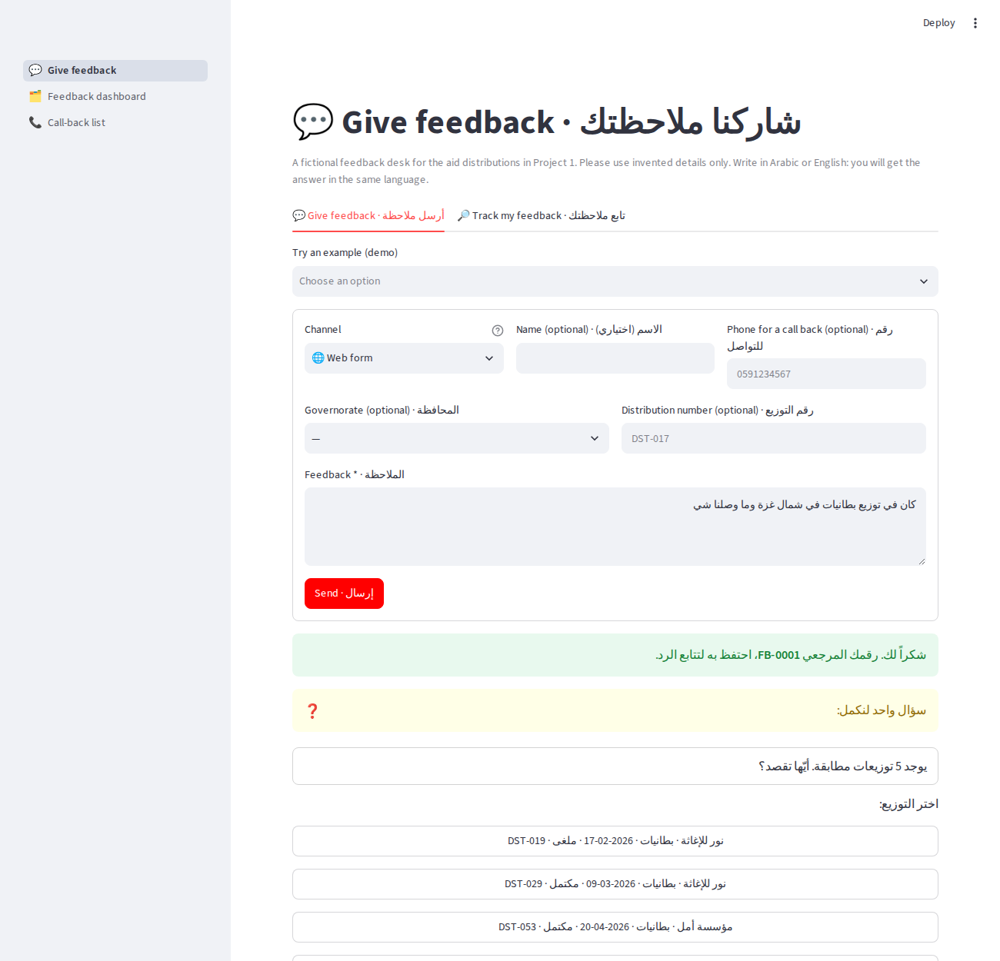
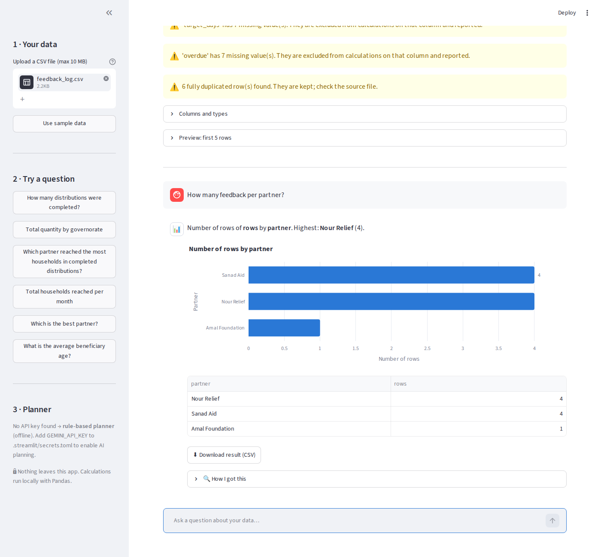
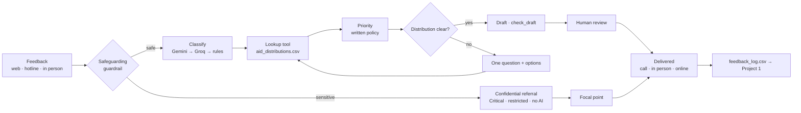
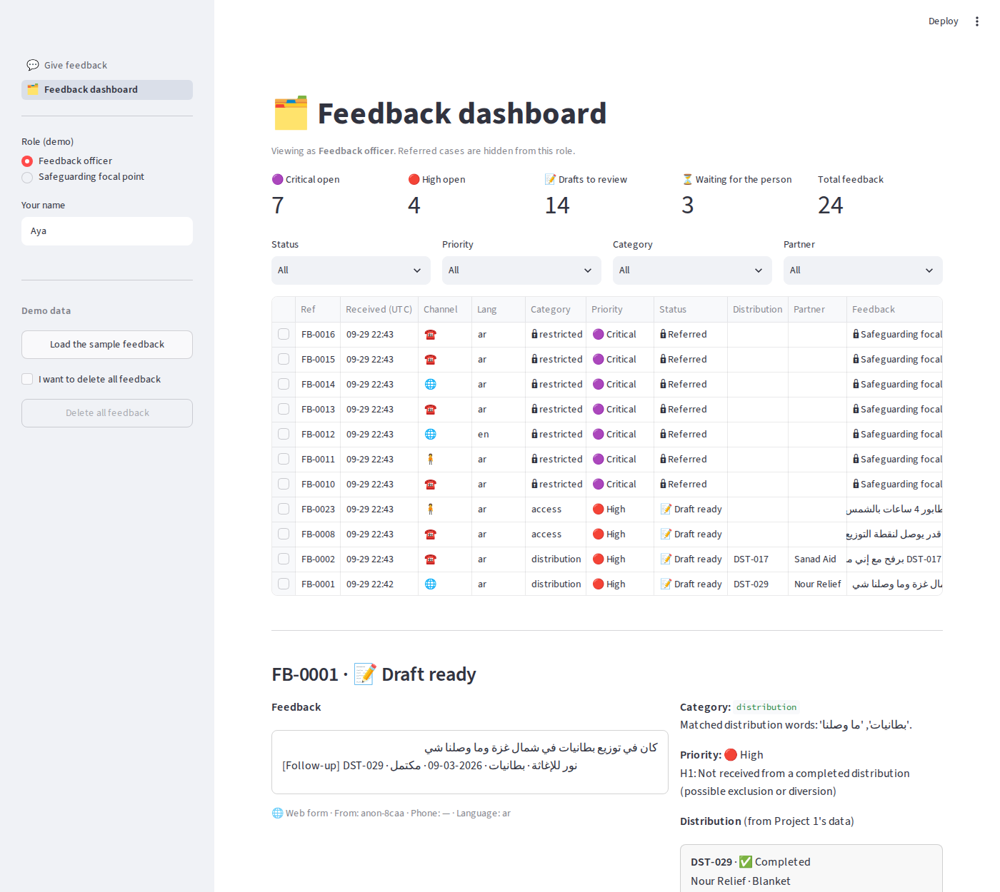
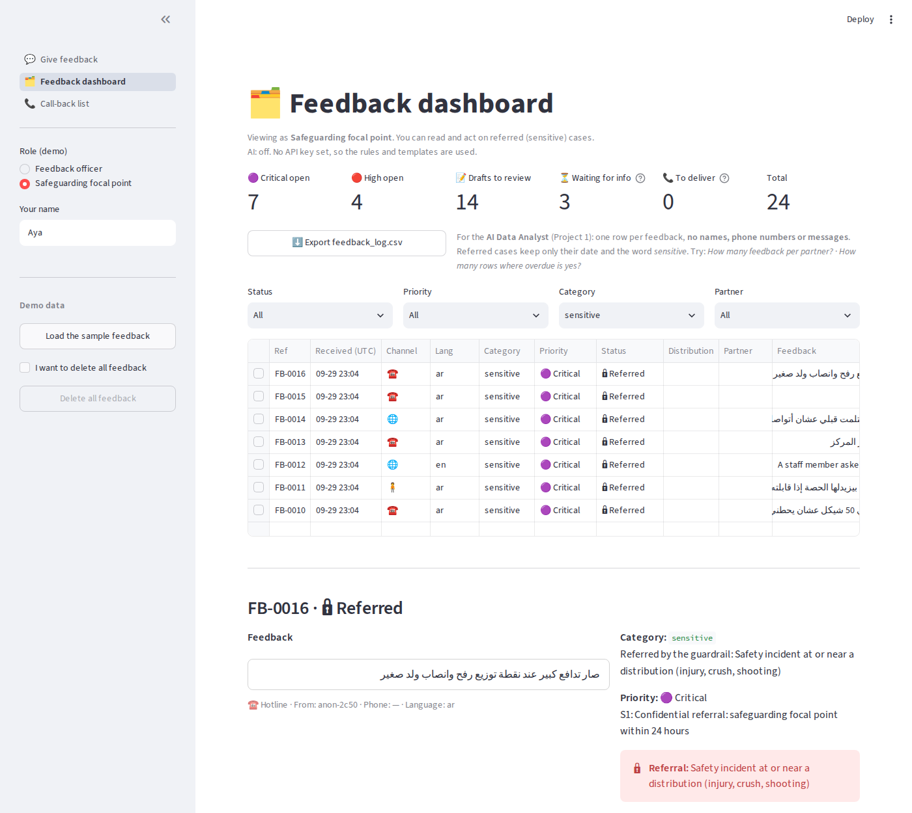
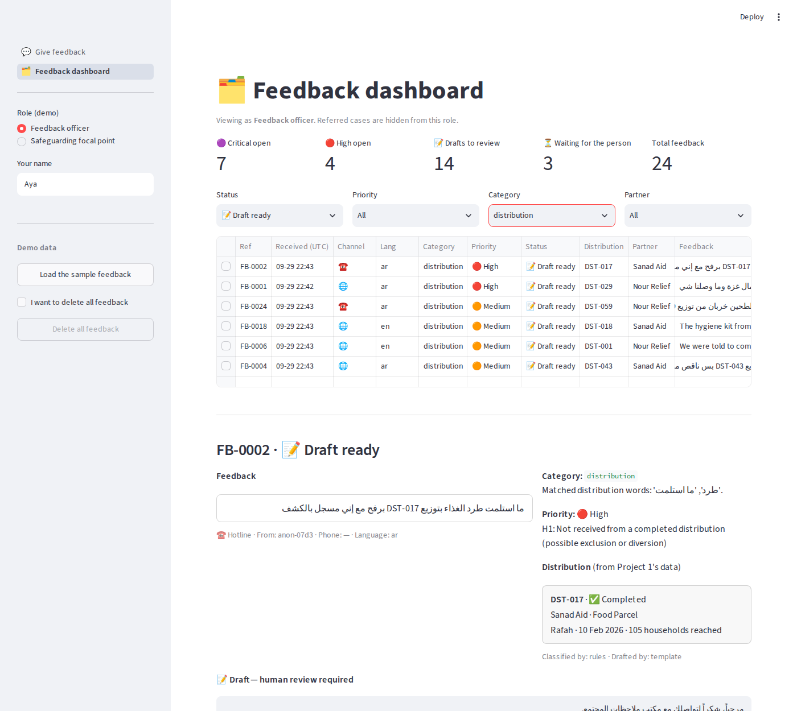
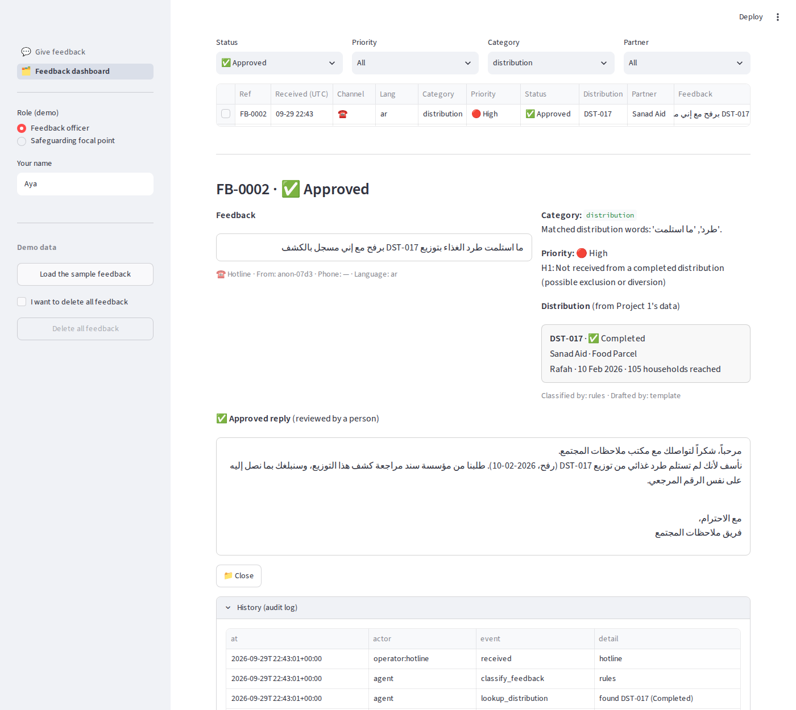
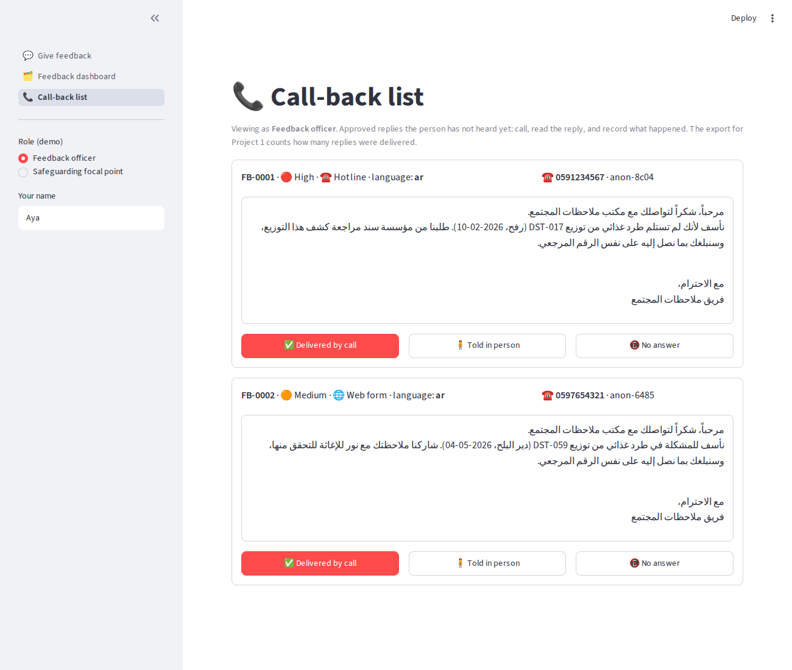
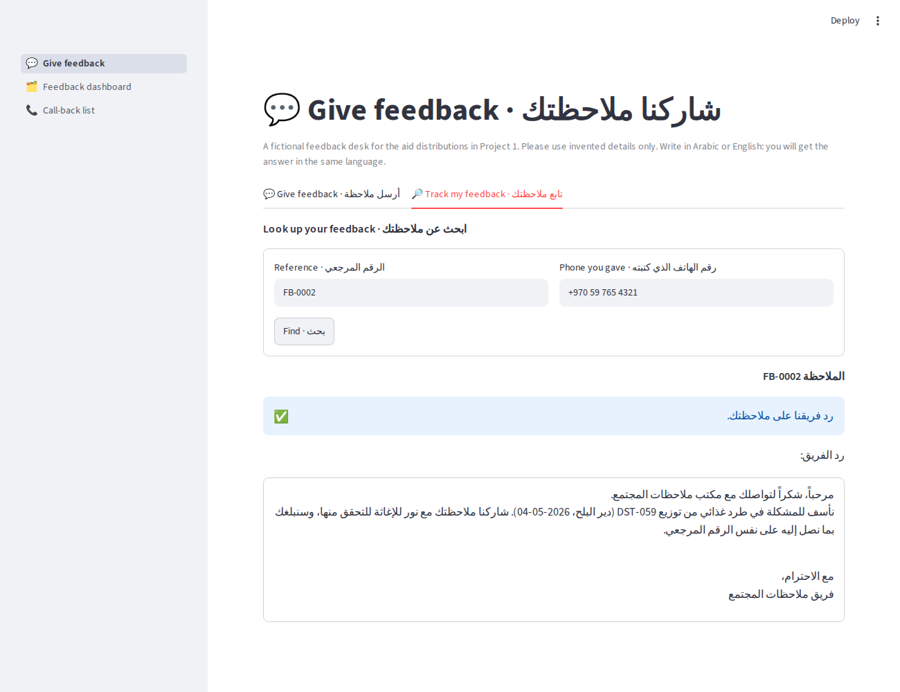

# 💬 AI Community Feedback Desk

**Community feedback about aid distributions, in Arabic and English: every complaint linked to its distribution, every sensitive report sent to a trained person, every reply approved by a human, and delivered.**
Continues [AI Data Analyst](https://github.com/Ayatalat0101/ai-data-analyst) (Project 1): the same distributions, the same data file, and an anonymised export that Project 1 analyses.


> **Live demo:** _added after deployment (see [ai-community-feedback-desk](https://ai-community-feedback-desk-wvsurexypoxdjdi664wxdk.streamlit.app/))._
> Project B of the *AI Systems Building Challenge* · [خطة المشروع بالعربي](PROJECT_PLAN_AR.md)



---

## The problem

After aid distributions in Gaza, people call a hotline or stop a volunteer to say *"I didn't receive"*, *"the flour was spoiled"*, *"a staff member asked me for money"*. The feedback ends up in a WhatsApp group or a notebook. Nobody checks which distribution it concerns, urgent cases wait, and a report of sexual exploitation can be read by anyone on the team.

**Example:** *"ما استلمت طرد الغذاء بتوزيع DST-017 برفح مع إني مسجل بالكشف"*. DST-017 is a **completed** Sanad Aid distribution, so this family may have been left off the list. That should be High priority, checked with Sanad Aid, and answered.

*All organisations, people, phone numbers and messages in this project are fictional.*

## How it continues Project 1

```
Project 1: aid_distributions.csv ──► AI Data Analyst ──► "households reached per partner"
                   │
                   ▼  lookup tool (status, partner, place, item)
Project 2: feedback ──► AI Community Feedback Desk ──► feedback_log.csv ──► AI Data Analyst ──► "complaints per partner"
```

1. **The agent's tool reads Project 1's file.** "Blankets in North Gaza" → the 5 real matching distributions, offered as buttons. DST-099 → "we could not find it, please check the number". A cancelled distribution gets a reply that says so.
2. **The export goes back into Project 1.** `feedback_log.csv` has one row per feedback and no personal data. The AI Data Analyst answers *"How many feedback per partner?"*, *"How many rows where overdue is yes?"*, *"count by delivered_via"*.



## What it does

| | |
|---|---|
| 💬 **Receives feedback** | Web form, hotline or in person (operators enter it for the person). Arabic, Gaza dialect or English. Name optional. |
| 🔒 **Refers sensitive reports first** | Sexual exploitation (PSEA), bribes, threats, injuries, self-harm, requests for others' data → **Critical**, no AI draft, visible **only to the safeguarding focal point**, never sent to an AI service. |
| 🗂️ **Classifies** | distribution · information · conduct · access · appreciation, with the reason. Gemini, rules as fallback. |
| 🔎 **Links the distribution** | A lookup tool over `aid_distributions.csv`. It never invents one: one match → linked; several → one question with options; none → asks. |
| 🚦 **Prioritises by a written policy** | S1 Critical · H1 not received from a *completed* distribution · H2 access barrier for older people, people with disabilities, pregnant women, children · M1–M3 · L1. The AI never sets priority. |
| 📝 **Drafts the reply** | In the language of the feedback, built on the distribution's real status. Checked: no promise of aid, no ID request, no other distribution number, right language. |
| 👤 **Human approval** | Approve · edit · reject · refer · close, with an audit log. |
| 📞 **Delivers the answer** | Call-back list for hotline operators, "Track my feedback" page, confidential contact for referred cases. `delivered` is a status of its own. |
| 📤 **Exports for Project 1** | Anonymised `feedback_log.csv` with distribution status, days open, overdue and whether the reply was delivered. |

## Who decides what

| Decision | Made by | Why |
|---|---|---|
| Confidential referral | **Code first**; the LLM may only *add* one | A safeguarding decision cannot depend on a model that can be tricked, rate-limited or down |
| Category | **Gemini** (structured output), rules as fallback | Meaning and dialect ("الكرتونة وصلت مبلولة") |
| Which distribution | **Code: lookup tool** | A fact, not a guess |
| Priority | **Code: written policy** | Must be explainable and testable |
| Reply wording | **Gemini**, from approved content + real facts | Natural, respectful, no invented commitments |
| Who can read a sensitive case | **Code: role check** in the agent | Confidentiality is a rule, not a screen setting |
| The reply sent | **A person** | Accountability to affected people |



## Screenshots

| Officer view: sensitive cases locked | Focal point view: the referral |
|---|---|
|  |  |
| **Draft with the distribution card from Project 1** | **Approved reply + audit log** |
|  |  |
| **Call-back list: closing the loop** | **The person reads the reply** |
|  |  |

## Results

**302 automated tests**, all 15 acceptance tests from the plan, 11 defects found and fixed (plus one in Project 1). Details: [TEST_RESULTS.md](TEST_RESULTS.md).

| | Rules, 23 samples | Rules, 14 **held-out** messages | Gemini |
|---|---|---|---|
| Category correct | 23/23 | 8/14 | run `python benchmark.py` |
| Action correct | 23/23 | 11/14 | |
| New sensitive wordings referred | — | 0/3 | |
| Drafts passing the safety check | 13/13 | 13/13 | |

The rules were written while looking at the 23 samples, so that score flatters them. The **holdout** was never used for tuning: it shows keyword rules miss new wordings, including three sensitive reports. That is the case for letting the LLM add referrals, and the number to watch when Gemini runs.

## Run it locally

Python 3.11+.

```bash
git clone https://github.com/Ayatalat0101/ai-community-feedback-desk.git
cd ai-community-feedback-desk
python -m venv .venv
source .venv/Scripts/activate      # Windows Git Bash  (PowerShell: .venv\Scripts\activate · macOS/Linux: source .venv/bin/activate)
pip install -r requirements.txt
python -m pytest -q                # 302 passed (301 + 1 skipped if ai-data-analyst is not in the parent folder)
streamlit run app.py
```

Works **without an API key** (rules + templates). To turn on Gemini:

```bash
python setup_key.py          # paste the key from aistudio.google.com/apikey
python -m feedback.llm       # RESULT: OK ✅, or the exact reason the key was not found
python benchmark.py          # fills the Gemini columns in BENCHMARK.md
```

Try it: **Give feedback** → *كان في توزيع بطانيات في شمال غزة وما وصلنا شي* and pick a distribution. **Feedback dashboard** → *Load the sample feedback*, switch the role in the sidebar. **Call-back list** → deliver a reply. **Export feedback_log.csv** → upload it to the [AI Data Analyst](https://github.com/Ayatalat0101/ai-data-analyst).

## Deploy on Streamlit Community Cloud

1. Push to GitHub.
2. [share.streamlit.io](https://share.streamlit.io) → **Create app** → `Ayatalat0101/ai-community-feedback-desk`, branch `main`, file `app.py`.
3. **Advanced settings → Secrets:** `GEMINI_API_KEY = "your-key"` (never commit it).
4. Deploy and put the link in the *Live demo* line above.

The public demo limits AI use to 20 messages per browser session. Data lives in SQLite on the app server and resets when the app restarts. The role switch in the sidebar is for the demo; a real deployment needs staff login.

## Project structure

```
app.py                     entry point: three pages
ui.py                      shared UI helpers (display only)
views/give_feedback.py     give feedback + track my feedback
views/dashboard.py         queue, review, roles, export
views/callbacks.py         call-back list (delivering replies)
feedback/models.py         contracts and fixed vocabularies
feedback/store.py          SQLite + audit log + in-place upgrades
feedback/text.py           Arabic normalisation, language detection
feedback/guardrail.py      safeguarding referral, before any AI
feedback/policy.py         written priority policy
feedback/distributions.py  the agent's tool over Project 1's data
feedback/classifier.py     rule classifier (fallback)
feedback/drafter.py        status-aware templates + check_draft
feedback/agent.py          the agent loop and staff actions
feedback/llm.py            Gemini / Groq chain
feedback/customer_view.py  what a person may see
feedback/export.py         anonymised feedback_log.csv
feedback/config.py         where the API key comes from
setup_key.py · benchmark.py
data/aid_distributions.csv   Project 1's data (unchanged)
data/sample_feedback.csv     25 test messages with expected results
data/holdout_feedback.csv    14 messages kept for honest evaluation
tests/                       302 tests
```

## Limits

- The guardrail is a list of patterns. It misses wordings it has never seen (0/3 on the holdout); the LLM flag is the second layer, and a trained person reviews every referral.
- The vulnerability rule (H2) recognises words like "كبيرة بالسن" or "wheelchair", not ages written as numbers ("عمرها 80 سنة").
- Replies are delivered by call-back, in person or on the Track page; there is no SMS gateway.
- Demo only: no staff login, and SQLite on a free server. A real deployment needs authentication, a hosted database and a data-protection review.

## Author

**Aya Talat Samra** · [GitHub](https://github.com/Ayatalat0101) · MIT licence
Plan written before code: [PROJECT_PLAN.md](PROJECT_PLAN.md) · [بالعربي](PROJECT_PLAN_AR.md)
